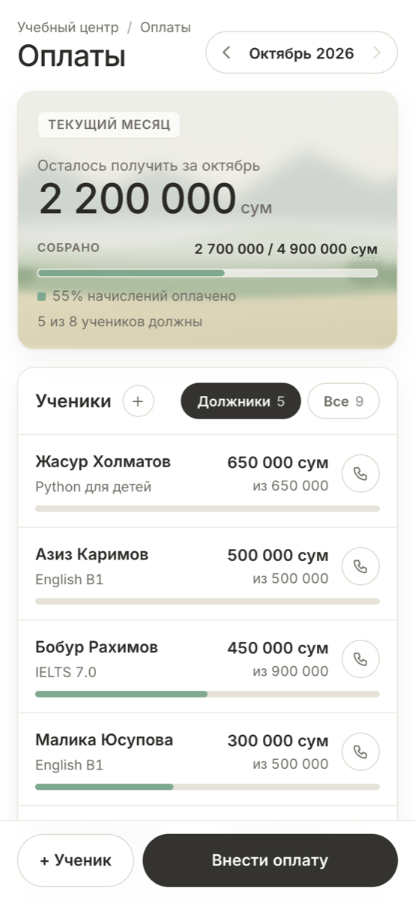
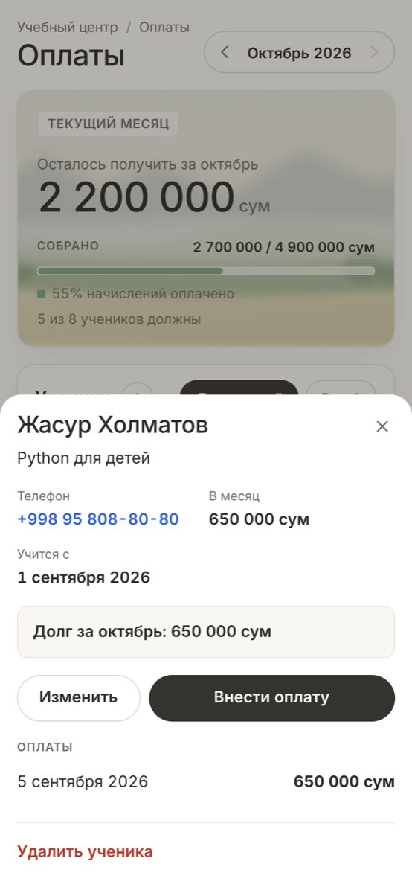
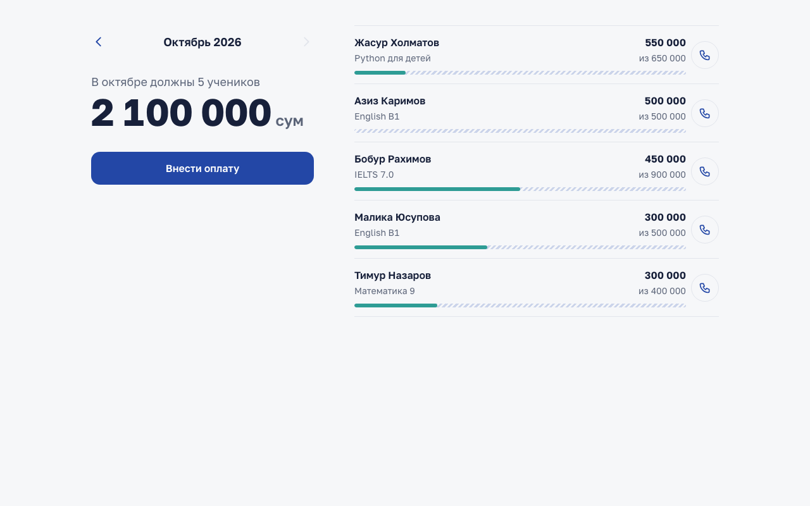
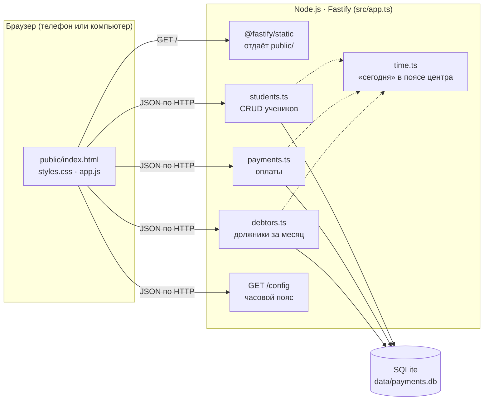
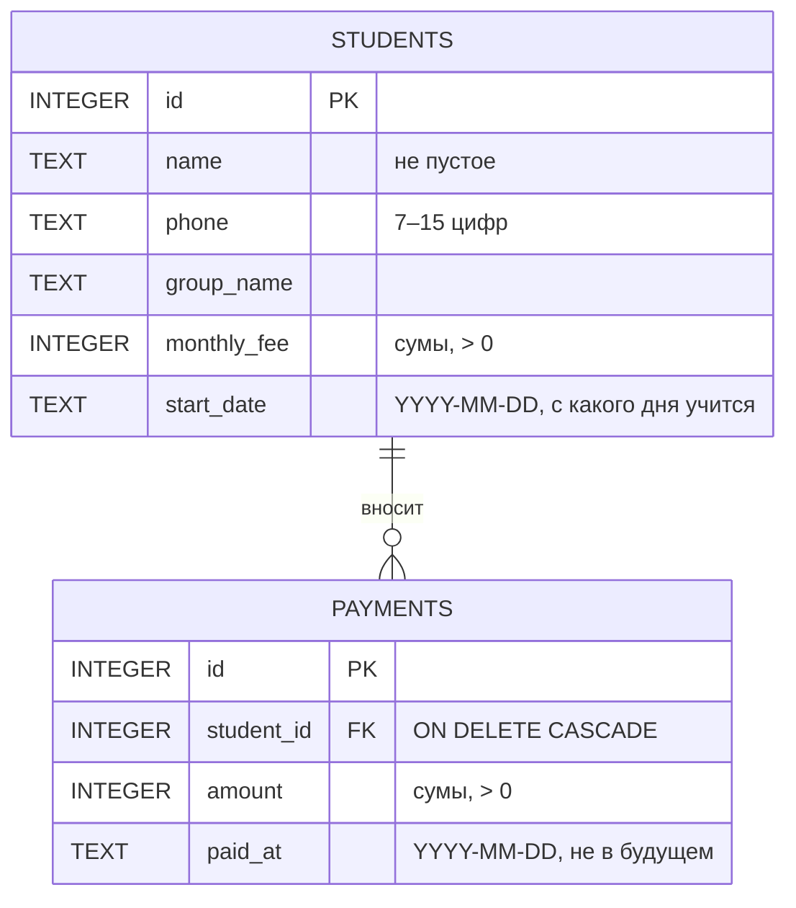
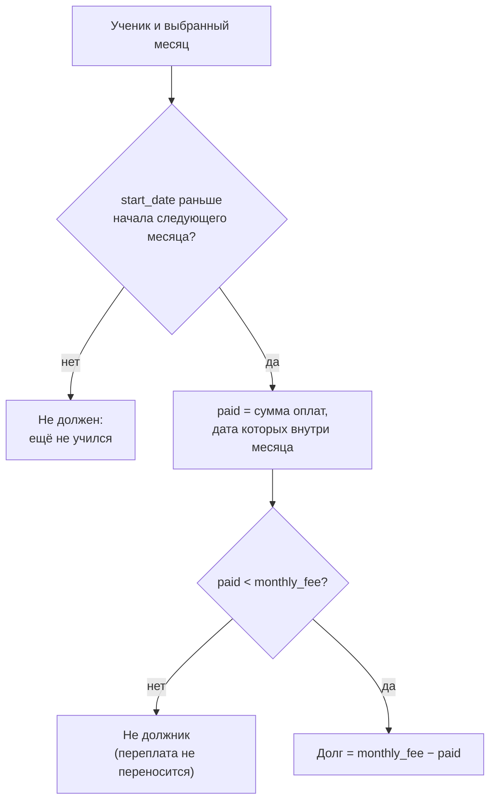
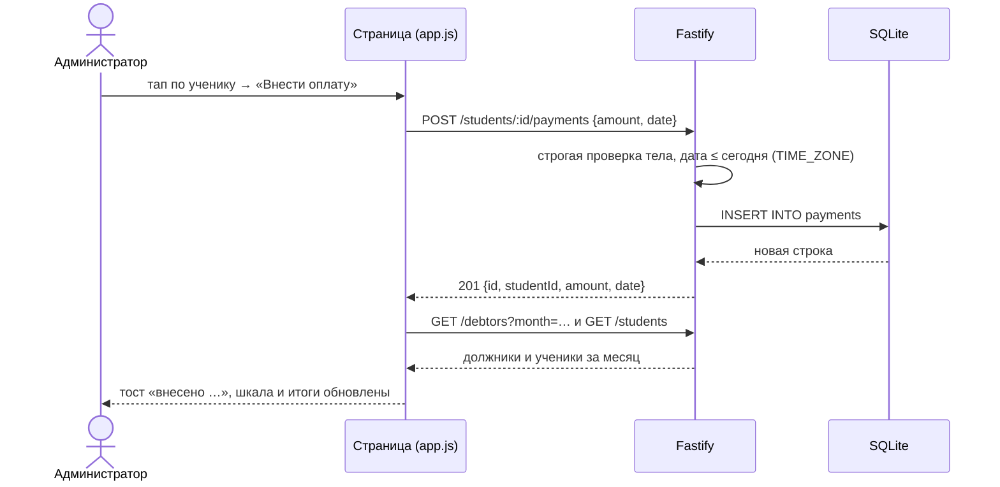

# Учёт оплат учебного центра

[](https://github.com/RiobVO/edu-payments/actions/workflows/test.yml)


Мини-учёт оплат для учебного центра: ученики, оплаты и должники за месяц. Внутри REST API на Fastify с SQLite и веб-страница для телефона (тестовое задание Ecomdev, интерфейс по варианту Б).

<p>
  
  
</p>



## Содержание

- [Быстрый старт](#быстрый-старт)
- [Соответствие заданию](#соответствие-заданию)
- [Возможности страницы](#возможности-страницы)
- [Архитектура](#архитектура)
- [Модель данных](#модель-данных)
- [Как считается долг](#как-считается-долг)
- [API](#api)
- [Тесты и проверка](#тесты-и-проверка)
- [Решения и компромиссы](#решения-и-компромиссы)
- [Что бы я улучшил, будь у меня ещё неделя](#что-бы-я-улучшил-будь-у-меня-ещё-неделя)

## Быстрый старт

Нужен Node.js 22.13 или новее, лучше 24 LTS. Docker и отдельная СУБД не нужны: данные хранятся в SQLite-файле, он создаётся при первом запуске.

```bash
git clone https://github.com/RiobVO/edu-payments.git
cd edu-payments
npm ci
npm run build
npm run seed     # необязательно: 9 демо-учеников с оплатами за прошлый и текущий месяц
npm start        # страница и API на http://localhost:3000
```

Открыть страницу с телефона в той же Wi-Fi-сети: `HOST=0.0.0.0 npm start`, затем `http://<IP компьютера>:3000`.

| Переменная  | По умолчанию       | Назначение                                                  |
|-------------|--------------------|-------------------------------------------------------------|
| `PORT`      | `3000`             | порт HTTP-сервера                                           |
| `HOST`      | `127.0.0.1`        | `0.0.0.0` открывает доступ из локальной сети                |
| `DB_PATH`   | `data/payments.db` | путь к файлу базы                                           |
| `TIME_ZONE` | `Asia/Tashkent`    | пояс, по которому определяются «сегодня» и «текущий месяц» |

На Node 22 при старте выводится `ExperimentalWarning: SQLite is an experimental feature`, на работу это не влияет. CI проверяет проект на Node 22.13, 24 и 26.

## Соответствие заданию

| Пункт задания | Где реализовано | Как проверить |
|---|---|---|
| 1.1 Ученики: имя, телефон, группа, месячная сумма; создание, список, изменение, удаление | `src/students.ts` | `POST/GET/PATCH/DELETE /students`, `test/students.test.ts` |
| 1.2 Оплаты: ученик, сумма, дата; добавление и список по ученику | `src/payments.ts` | `POST/GET /students/:id/payments`, `test/payments.test.ts` |
| 1.3 `GET /debtors?month=YYYY-MM`: кто заплатил меньше месячной суммы и сколько должен | `src/debtors.ts` | `test/debtors.test.ts` |
| 1. Хранение в БД | SQLite, `src/db.ts` | файл `data/payments.db` |
| 2. Вариант Б: список должников и форма оплаты, удобная на телефоне | `public/` | `npm start`, открыть с телефона |
| 3.1 Запуск с нуля | раздел [Быстрый старт](#быстрый-старт) | команды выше на чистом клоне |
| 3.2 Что улучшить за неделю | [последний раздел](#что-бы-я-улучшил-будь-у-меня-ещё-неделя) | — |

## Возможности страницы

- Карточка месяца: сколько осталось получить и сколько собрано от начислений. Месяцы листаются стрелками.
- Должники с остатком и шкалой «внесено / недостаёт». Переключатель «Должники / Все ученики».
- Карточка ученика: долг за месяц, история оплат, звонок по тапу, изменение и удаление с подтверждением.
- Форма оплаты: ученик и сумма долга подставляются сами, дата по умолчанию сегодняшняя, подсказка «засчитается за октябрь».
- Форма «+ Ученик» с датой «Учится с», от которой считаются долги.
- На широком экране слева список групп: по каждой видно, сколько учеников должны и на какую сумму, клик фильтрует таблицу.

## Архитектура

Один процесс Node.js отдаёт и API, и статическую страницу. Страница написана без фреймворка и шага сборки: три файла в `public/`.



Зависимости (база и часы) передаются в `buildApp()` явно. Поэтому тесты поднимают приложение с базой в памяти и фиксированной датой, без сети и без моков.

```
src/
  app.ts        сборка Fastify-приложения и строгой валидации
  students.ts   CRUD учеников
  payments.ts   оплаты
  debtors.ts    расчёт должников (один SQL-запрос)
  db.ts         схема SQLite и миграция
  time.ts       даты в часовом поясе центра
  server.ts     точка входа
  seed.ts       демо-данные
public/         страница: index.html, styles.css, app.js, шрифт Inter, фон-пейзаж (свой SVG)
test/           тесты Vitest через fastify.inject
```

## Модель данных



Id выдаются с `AUTOINCREMENT` и никогда не переиспользуются. Индекс `payments(student_id, paid_at)` покрывает и историю ученика, и выборку оплат за месяц.

## Как считается долг



Всё это делает один SQL-запрос в `src/debtors.ts`. Условие на дату оплаты стоит в `LEFT JOIN … ON`, а не в `WHERE`, иначе из результата выпали бы ученики без единой оплаты, то есть главные должники.

- Начавший учиться в середине месяца должен полную сумму.
- Несколько оплат за месяц складываются.
- Список отсортирован по убыванию долга.
- «Сегодня» и «текущий месяц» берутся в поясе `TIME_ZONE`. Оплата 1-го числа в 01:00 по Ташкенту относится к новому месяцу, хотя по UTC это ещё предыдущий.

## API

Все суммы — целые числа в сумах, даты — строки `YYYY-MM-DD`.

| Метод    | Путь                       | Назначение                                     | Успех |
|----------|----------------------------|------------------------------------------------|-------|
| `POST`   | `/students`                | создать ученика                                | `201` |
| `GET`    | `/students`                | список учеников по алфавиту                    | `200` |
| `GET`    | `/students/:id`            | один ученик                                    | `200` |
| `PATCH`  | `/students/:id`            | изменить любые поля                            | `200` |
| `DELETE` | `/students/:id`            | удалить ученика вместе с его оплатами          | `204` |
| `POST`   | `/students/:id/payments`   | добавить оплату                                | `201` |
| `GET`    | `/students/:id/payments`   | оплаты ученика, сначала новые                  | `200` |
| `GET`    | `/debtors?month=YYYY-MM`   | должники за месяц; без `month` — за текущий    | `200` |
| `GET`    | `/config`                  | часовой пояс центра для страницы               | `200` |

**Ошибки.** `400` означает неверные данные, `404` — ученика нет. В теле ошибки всегда есть поле `message`. Валидация строгая: `"500000"` вместо числа, `true`, дробная сумма, несуществующая дата (`2026-02-30`), оплата датой из будущего или неизвестное поле (опечатка `monthly_fee`) получают `400`, а не тихо приводятся и не пропускаются.

### Сценарий целиком

Команды выполняются по порядку на запущенном сервере, с демо-данными или без. Id ученика берётся из ответа, удаление стоит последним.

```bash
BASE=http://localhost:3000

# 1. Создать ученика (startDate необязателен, по умолчанию сегодня) и запомнить его id
ID=$(curl -s -X POST $BASE/students -H 'Content-Type: application/json' \
  -d '{"name":"Сардор Юсупов","phone":"+998 90 123-45-67","group":"English B1","monthlyFee":500000,"startDate":"2026-09-01"}' \
  | node -p 'JSON.parse(require("fs").readFileSync(0, "utf8")).id')
echo "id ученика: $ID"

# 2. Список и изменение
curl -s -w '\n' $BASE/students
curl -s -w '\n' -X PATCH $BASE/students/$ID -H 'Content-Type: application/json' -d '{"monthlyFee":550000}'

# 3. Оплата (date необязателен, по умолчанию сегодня) и история оплат ученика
curl -s -w '\n' -X POST $BASE/students/$ID/payments -H 'Content-Type: application/json' -d '{"amount":200000,"date":"2026-10-05"}'
curl -s -w '\n' $BASE/students/$ID/payments

# 4. Должники за октябрь: ученик должен 550 000 − 200 000 = 350 000
curl -s -w '\n' "$BASE/debtors?month=2026-10"

# 5. Удаление: вместе с учеником удаляются его оплаты, ответ 204
curl -s -o /dev/null -w '%{http_code}\n' -X DELETE $BASE/students/$ID
```

Ответы шагов 1–4 (id зависит от базы):

```json
{ "id": 1, "name": "Сардор Юсупов", "phone": "+998 90 123-45-67", "group": "English B1", "monthlyFee": 500000, "startDate": "2026-09-01" }
```

```json
[{ "id": 1, "studentId": 1, "amount": 200000, "date": "2026-10-05" }]
```

```json
{
  "month": "2026-10",
  "totalDebt": 350000,
  "debtors": [
    {
      "studentId": 1,
      "name": "Сардор Юсупов",
      "phone": "+998 90 123-45-67",
      "group": "English B1",
      "monthlyFee": 550000,
      "paid": 200000,
      "debt": 350000
    }
  ]
}
```

С демо-данными в `debtors` будут и другие ученики, а `totalDebt` станет больше.

### Как страница вносит оплату



Ответы могут приходить не по порядку: быстро листают месяцы, закрыли шторку до ответа и открыли другую. Для этого у загрузки месяца, истории ученика, сохранения ученика, оплаты и удаления есть счётчик открытий. Ответ на устаревший запрос только обновляет список и не перепишет экран, не закроет и не изменит открытую с тех пор шторку. Каждый такой случай воспроизведён в сквозном сценарии с искусственной задержкой ответа.

## Тесты и проверка

```bash
npm test            # 67 тестов Vitest
npm run typecheck   # tsc в строгом режиме, включая тесты
```

- Тесты поднимают приложение через `fastify.inject` с базой в памяти и зафиксированной датой. Покрыты CRUD, валидация, все правила долга, границы месяца и часового пояса, непереиспользуемые id, миграции старых баз.
- CI (GitHub Actions) на каждый push гоняет typecheck, тесты и сборку на Node 22.13, 24 и 26.
- Страница проверялась сквозным сценарием через Chrome DevTools Protocol на эмуляции телефона 390×844. В сценарии: оплата, добавление, изменение и удаление ученика, фильтр по группе, гонки запросов. Этот скрипт в репозиторий не входит, перенести его в CI — пункт 5 списка ниже.

## Решения и компромиссы

| Решение | Почему | Цена |
|---|---|---|
| Суммы — целые числа в сумах | float в деньгах даёт ошибки округления, а тийины на практике не используются | дробные суммы не поддерживаются |
| SQLite через встроенный `node:sqlite` | ноль нативных модулей: `npm ci` ничего не компилирует | нужен Node ≥ 22.13 |
| Строгая валидация (`coerceTypes: false`, `removeAdditional: false`) | по умолчанию Fastify превращал `true` в `1` и молча выкидывал поле с опечаткой | клиент обязан слать правильные типы |
| Оплата засчитывается в месяц своей даты | простая и проверяемая модель для первой версии | долг за прошлый месяц, погашенный сегодня, уйдёт в текущий (пункт 2 ниже) |
| Оплату датой из будущего API не примет | это почти всегда опечатка, которая молча закрыла бы долг не того месяца | предоплату нельзя внести будущей датой |
| Удаление ученика удаляет и его оплаты (`ON DELETE CASCADE`) | задание требует удалять ученика, а оплаты без ученика были бы висячими записями; архив — отдельная функция | осознанное упрощение: история оплат теряется (пункт 4 ниже) |
| `AUTOINCREMENT` для id | без него SQLite отдаёт id удалённого последнего ученика новому, и оплата по старой ссылке записалась бы другому человеку | старые базы перестраиваются миграцией при запуске |
| Страница без фреймворка, вывод только через `textContent` | нечего собирать, а имя вида `` не станет XSS | ручная работа с DOM |
| Шрифт и фон лежат в репозитории | страница не делает сторонних запросов и работает без интернета | +70 КБ шрифтов |

## Что бы я улучшил, будь у меня ещё неделя

1. **Авторизация.** Сейчас API открыт любому, кто достучится до порта, а речь о деньгах. Нужен вход для сотрудников и роли: администратор вносит оплаты, владелец смотрит отчёты.
2. **Месяц оплаты отдельно от даты.** Нужно поле «за какой месяц» и перенос переплаты на следующие месяцы, чтобы погашение старого долга не попадало в текущий месяц.
3. **История тарифов.** Сейчас изменение месячной суммы пересчитывает и прошлые месяцы. Нужна таблица тарифов с датой начала действия, а для начавших в середине месяца — расчёт пропорционально дням.
4. **Архив вместо удаления и отмена ошибочной оплаты.** Ушедший ученик остаётся в архиве со всей историей, ошибочную оплату можно отменить с указанием причины, изменения пишутся в журнал.
5. **Telegram-бот** (вариант А) поверх того же API, напоминания должникам и сквозной тест страницы в CI.
